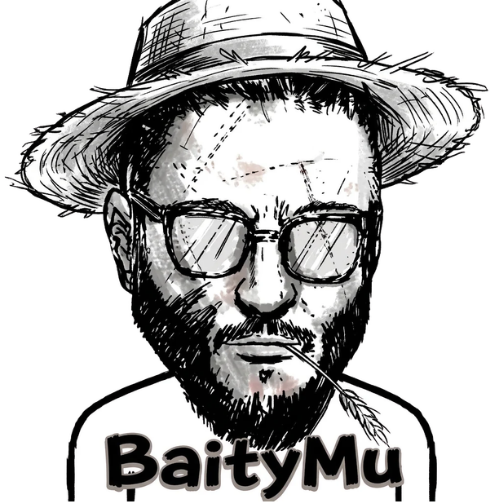

<p align="center"></p>

# BaityMu

API Web en .NET con arquitectura en capas para la granja lechera de Baity. Cubre la producción de leche, la transformación en queso y yogurt, el inventario por lotes con salida FIFO, las ventas y los reportes.

Taller final de **Lenguajes de Programación**, Universidad Santiago de Cali.
Docente: Camilo Ernesto Charry Caicedo · Estudiante: Monica Alexandra Ruiz Martinez.

## Estado

**Fase de análisis y diseño.** Todavía no hay código. El trabajo se organiza en el GitHub Project **BaityMu** (épicas e historias de usuario como issues).

## Documentación

| Documento | Contenido |
|---|---|
| [Historias de usuario](docs/HistoriasDeUsuario.md) | Problema, reglas de negocio, requisitos funcionales y no funcionales, roles Baity, 21 historias con criterios de aceptación y tareas de desarrollo |
| [Base de datos](docs/BaseDeDatos.md) | Modelo entidad-relación en SQL Server, tablas, restricciones, índices y decisiones de diseño |
| [Documentación en PDF](docs/BaityMu-Documentacion.pdf) | Todo lo anterior en un solo documento para entregar |

## Tecnologías previstas

- .NET 10 · ASP.NET Core Web API · C#
- Entity Framework Core 10 con migraciones · SQL Server (LocalDB en desarrollo)
- AutoMapper · Swagger/OpenAPI · ProblemDetails
- NUnit para las pruebas unitarias

## Arquitectura

```text
BaityMu.Web → BaityMu.Services → BaityMu.Infrastructure → BaityMu.Domain
```

Domain no depende de ninguna otra capa. Ahí viven las entidades, las reglas de los lotes y las interfaces de los repositorios.
