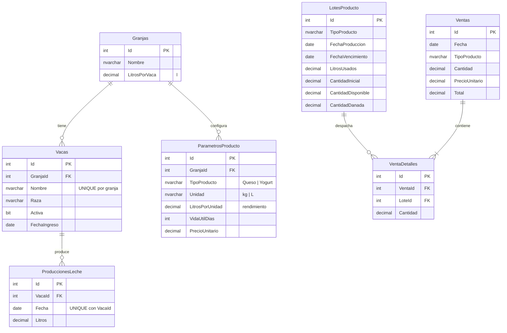

<p align="center"></p>

# BaityMu — Diseño de la base de datos

- **Motor**: **SQL Server**. En desarrollo se usa **SQL Server LocalDB**, que se instala con Visual Studio.
- **Base de datos**: `BaityMu`.
- **Acceso**: Entity Framework Core 10 con el proveedor `Microsoft.EntityFrameworkCore.SqlServer` y migraciones (RNF-03).
- **Cobertura**: el modelo cubre las historias HU-01 a HU-21 y las reglas RN-01 a RN-10.

## Conexión

Cadena de conexión en `appsettings.json` (LocalDB, autenticación de Windows):

```json
"ConnectionStrings": {
  "DefaultConnection": "Server=(localdb)\\MSSQLLocalDB;Database=BaityMu;Trusted_Connection=True;TrustServerCertificate=True"
}
```

Para usar un SQL Server completo (o en Docker) solo hay que cambiar esta cadena. El código no cambia.

> **Requisito en Visual Studio**: la carga de trabajo **"Desarrollo de ASP.NET y web"** (o **"Almacenamiento y procesamiento de datos"**) instala LocalDB. Para verificarlo, ejecuta `sqllocaldb info` en una terminal; debe aparecer `MSSQLLocalDB`.

## Diagrama entidad-relación



## Tipos usados

| En C# | En SQL Server | Por qué |
|---|---|---|
| `int` (Id) | `int IDENTITY(1,1)` | Clave autoincremental |
| `string` | `nvarchar(n)` | Admite tildes y la ñ (*Muñeca*, *Dañado*) |
| `decimal` | `decimal(p,s)` | **Exacto**: sin errores de redondeo en litros, kg ni pesos |
| `DateOnly` | `date` | El negocio trabaja por días, sin hora |
| `bool` | `bit` | |
| `enum TipoProducto` | `nvarchar(20)` | Se guarda como texto (`'Queso'`) para que la base sea legible |

## Tablas

### Granjas — configuración general (HU-05, HU-06)

| Columna | Tipo | Nulo | Restricciones | Notas |
|---|---|---|---|---|
| Id | int IDENTITY | No | PK | |
| Nombre | nvarchar(100) | No | | "Granja BaityMu" |
| LitrosPorVaca | decimal(10,2) | No | CHECK > 0 | **l** |

Solo existe una fila. Se siembra desde `appsettings.json` la primera vez que arranca la aplicación (RNF-09). **n no se guarda**: se calcula contando las vacas activas.

### Vacas — el hato (HU-01 a HU-04)

| Columna | Tipo | Nulo | Restricciones | Notas |
|---|---|---|---|---|
| Id | int IDENTITY | No | PK | |
| GranjaId | int | No | FK → Granjas.Id (NO ACTION) | |
| Nombre | nvarchar(60) | No | UNIQUE (GranjaId, Nombre) | La primera vaca es **BaityCow** |
| Raza | nvarchar(60) | No | | Holstein, Jersey, Normando... |
| Activa | bit | No | DEFAULT 1 | Al retirar una vaca se pone en 0; **nunca se borra** (RNF-11) |
| FechaIngreso | date | No | | |

Índice: (GranjaId, Activa), para calcular n y listar vacas rápido.

### ParametrosProducto — rendimiento, vida útil y precio (HU-05, HU-06)

| Columna | Tipo | Nulo | Restricciones | Notas |
|---|---|---|---|---|
| Id | int IDENTITY | No | PK | |
| GranjaId | int | No | FK → Granjas.Id (CASCADE) | |
| TipoProducto | nvarchar(20) | No | UNIQUE (GranjaId, TipoProducto) | |
| Unidad | nvarchar(10) | No | | kg, L |
| LitrosPorUnidad | decimal(10,3) | No | CHECK > 0 | Queso 10 · Yogurt 1 |
| VidaUtilDias | int | No | CHECK > 0 | Queso 30 · Yogurt 15 |
| PrecioUnitario | decimal(18,2) | No | CHECK ≥ 0 | |

### ProduccionesLeche — lo que dio cada vaca cada día (HU-07, HU-08, HU-20)

| Columna | Tipo | Nulo | Restricciones | Notas |
|---|---|---|---|---|
| Id | int IDENTITY | No | PK | |
| VacaId | int | No | FK → Vacas.Id (NO ACTION) | |
| Fecha | date | No | **UNIQUE (VacaId, Fecha)** | RN-01, garantizado por la base de datos |
| Litros | decimal(10,2) | No | CHECK ≥ 0 | |

Índice: Fecha, para el reporte de leche diaria y la transformación.

### LotesProducto — el inventario I (HU-09 a HU-12)

| Columna | Tipo | Nulo | Restricciones | Notas |
|---|---|---|---|---|
| Id | int IDENTITY | No | PK | |
| TipoProducto | nvarchar(20) | No | | |
| FechaProduccion | date | No | | Fecha de la leche usada |
| FechaVencimiento | date | No | CHECK ≥ FechaProduccion | Se calcula **al crear el lote** y queda fija |
| LitrosUsados | decimal(10,2) | No | CHECK > 0 | Para RN-02 y el reporte de leche |
| CantidadInicial | decimal(12,3) | No | CHECK > 0 | litros ÷ rendimiento (RN-03) |
| CantidadDisponible | decimal(12,3) | No | CHECK ≥ 0 | |
| CantidadDanada | decimal(12,3) | No | CHECK ≥ 0 | RN-08 |

Restricción adicional: `CantidadDisponible + CantidadDanada <= CantidadInicial`.

Índices:
- (TipoProducto, FechaProduccion, Id) INCLUDE (CantidadDisponible, FechaVencimiento): es el orden **FIFO** de la venta (RN-06).
- FechaProduccion: para saber cuánta leche de un día ya se transformó.
- FechaVencimiento: para procesar vencimientos y el reporte de producto dañado.

### Ventas — cabecera de la venta (HU-13 a HU-15)

| Columna | Tipo | Nulo | Restricciones | Notas |
|---|---|---|---|---|
| Id | int IDENTITY | No | PK | |
| Fecha | date | No | | |
| TipoProducto | nvarchar(20) | No | | |
| Cantidad | decimal(12,3) | No | CHECK > 0 | |
| PrecioUnitario | decimal(18,2) | No | CHECK ≥ 0 | **Copia** del precio en el momento de la venta (RN-09) |
| Total | decimal(18,2) | No | CHECK ≥ 0 | Cantidad × PrecioUnitario |

Índice: (Fecha, TipoProducto), para el reporte de ventas.

### VentaDetalles — trazabilidad lote por lote (RN-09)

| Columna | Tipo | Nulo | Restricciones | Notas |
|---|---|---|---|---|
| Id | int IDENTITY | No | PK | |
| VentaId | int | No | FK → Ventas.Id (CASCADE) | |
| LoteId | int | No | FK → LotesProducto.Id (**NO ACTION**) | No se puede borrar un lote que ya se vendió |
| Cantidad | decimal(12,3) | No | CHECK > 0 | |

Restricción: UNIQUE (VentaId, LoteId), porque una venta toma de cada lote una sola vez.
La fecha de producción que muestra la respuesta de venta se obtiene con un JOIN al lote; no se duplica.

> **Nota sobre SQL Server**: solo `ParametrosProducto` (desde Granjas) y `VentaDetalles` (desde Ventas) borran en cascada. Así no hay "múltiples rutas de cascada", que SQL Server no permite.

## Lo que NO se guarda (se calcula)

Estos valores no tienen columna. Si se guardaran, podrían quedar desactualizados respecto a los datos de los que salen.

| Dato | Cómo se obtiene |
|---|---|
| **n** (número de vacas) | `COUNT(*) FROM Vacas WHERE Activa = 1` |
| Producción diaria esperada | n × LitrosPorVaca |
| Leche producida en un día | `SUM(Litros) FROM ProduccionesLeche WHERE Fecha = @d` |
| Litros transformados en un día | `SUM(LitrosUsados) FROM LotesProducto WHERE FechaProduccion = @d` |
| Leche no aprovechada | producida − transformada |
| Cantidad vendida de un lote | CantidadInicial − CantidadDisponible − CantidadDanada |
| Estado del lote (Disponible, Agotado, Vencido, Dañado) | Se calcula con la fecha de consulta |
| Producción total de una vaca | `SUM(Litros) FROM ProduccionesLeche WHERE VacaId = @v` |

## Decisiones de diseño

1. **SQL Server en lugar de SQLite.** SQL Server tiene `decimal` exacto y `date` nativos, así que el FIFO (`ORDER BY`), los filtros de vencimiento y las sumas de los reportes se ejecutan en la base de datos sin conversiones ni pérdida de precisión.
2. **Una sola granja.** La tabla `Granjas` existe para colgar la configuración y las vacas, como en el diagrama del taller (Farm → Cow). Agregar más granjas en el futuro no exige cambiar el modelo.
3. **Los lotes no apuntan a una vaca ni a una producción.** La leche de un día se mezcla: un lote sale de "la leche del 2026-12-01", no de una vaca en particular. La relación con la producción es por **fecha**.
4. **Copias históricas.** `FechaVencimiento` del lote y `PrecioUnitario` de la venta se copian al momento de la operación. Así, si BaityAdministrador cambia la vida útil o el precio, el pasado no cambia (HU-06, criterio 3).
5. **Las reglas importantes también las protege la base de datos**, no solo el código: el UNIQUE (VacaId, Fecha) para RN-01, los CHECK de cantidades no negativas y el NO ACTION en los lotes vendidos.
6. **Enums como texto** (`'Queso'`, `'Yogurt'`): la base se puede leer sin consultar el código.
7. **La venta es una sola transacción.** El `SaveChanges` de EF Core sobre SQL Server confirma juntos la venta, sus detalles y el descuento de los lotes. Si algo falla, no queda nada a medias (RN-07, RNF-04).

## Pruebas unitarias y base de datos

Las pruebas **no usan SQL Server**, porque deben correr en cualquier PC sin instalar nada. Se usa el proveedor **EF Core InMemory** (`Microsoft.EntityFrameworkCore.InMemory`) con una base nueva por prueba y el `FakeClock`.

- El proveedor InMemory no hace cumplir los UNIQUE ni los CHECK. Por eso las reglas (por ejemplo, RN-01) también se validan en el dominio y los servicios, y eso es justamente lo que prueban las pruebas.
- Las restricciones de la base de datos son una segunda barrera que se comprueba al ejecutar la API contra LocalDB.

## El escenario de referencia dentro de las tablas (día 17)

**LotesProducto**

| Id | Tipo | FechaProduccion | FechaVencimiento | LitrosUsados | Inicial | Disponible | Dañada |
|---|---|---|---|---|---|---|---|
| 1 (Q1) | Queso | 2026-12-01 | 2026-12-31 | 100 | 10 | 0 | 0 |
| 2 (Y1) | Yogurt | 2026-12-01 | 2026-12-16 | 50 | 50 | 0 | 30 |
| 3 (Q2) | Queso | 2026-12-02 | 2027-01-01 | 150 | 15 | 13 | 0 |

**Ventas** y **VentaDetalles**

| Venta | Fecha | Tipo | Cantidad | Detalle (LoteId: cantidad) |
|---|---|---|---|---|
| 1 | 2026-12-03 | Queso | 12 | 1: 10 · 3: 2 |
| 2 | 2026-12-03 | Yogurt | 20 | 2: 20 |

**ProduccionesLeche**: 20 filas, 10 vacas × 2 días con 15 L cada una. La suma da 150 L por día.
